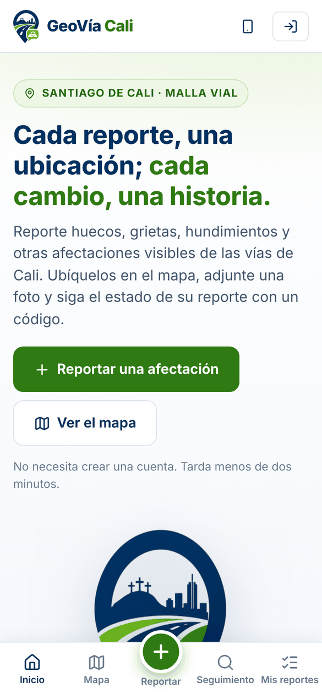
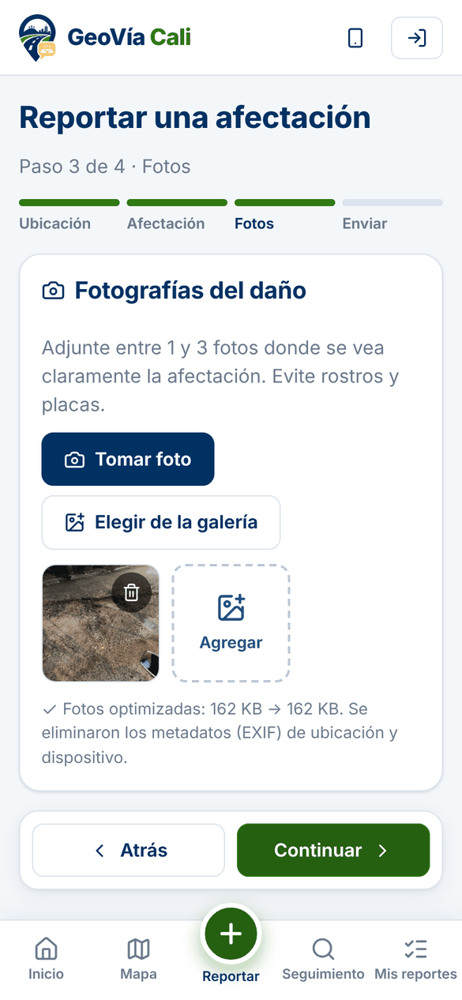
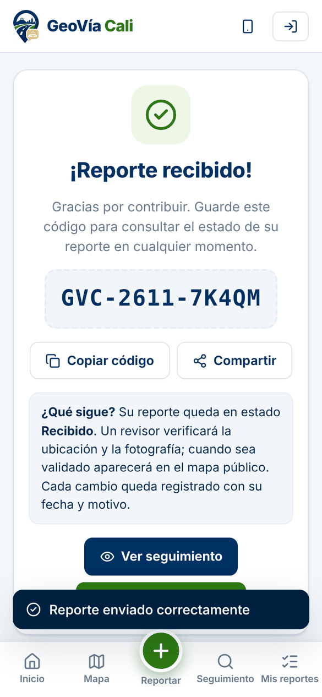
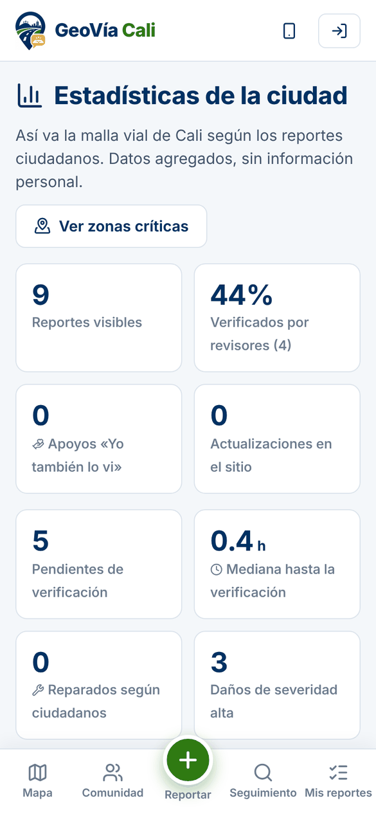
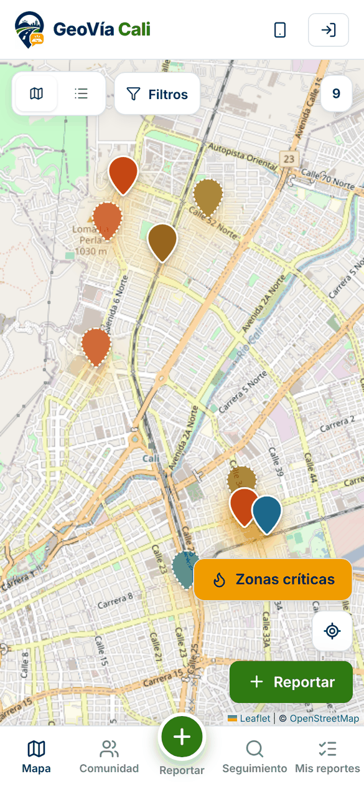
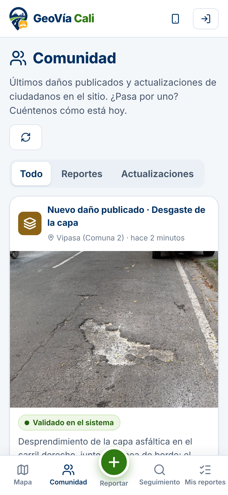
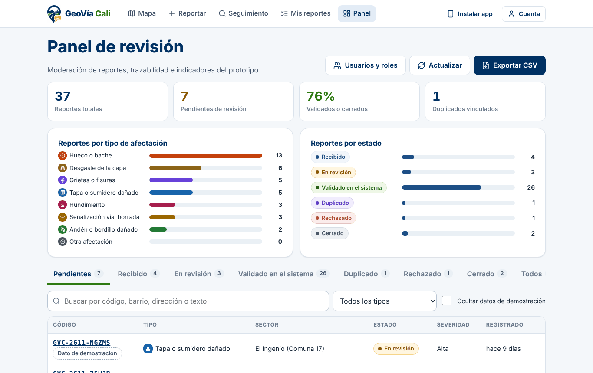

<p align="center">
  
</p>

<h1 align="center">GeoVía Cali</h1>

<p align="center">
  <b>Reporte ciudadano y seguimiento de afectaciones de la malla vial de Santiago de Cali</b><br>
  <i>Cada reporte, una ubicación; cada cambio, una historia.</i>
</p>

<p align="center">
  
  
  
  
</p>

<p align="center">
  <a href="#-qué-es">Qué es</a> ·
  <a href="#-funcionalidades">Funcionalidades</a> ·
  <a href="#-capturas">Capturas</a> ·
  <a href="#-arquitectura">Arquitectura</a> ·
  <a href="#-puesta-en-marcha">Puesta en marcha</a> ·
  <a href="#-pruebas">Pruebas</a> ·
  <a href="#-documentación">Documentación</a> ·
  <a href="#-autores">Autores</a>
</p>

---

## 📍 Qué es

**GeoVía Cali** es una aplicación web progresiva (PWA), instalable en el celular, para que cualquier persona **reporte huecos, grietas, hundimientos y otros daños visibles de las vías de Cali** con su ubicación exacta y una fotografía, y **haga seguimiento** a cada reporte con un código, sin necesidad de crear una cuenta.

Del otro lado, un equipo de **revisores** modera los reportes (los valida, detecta duplicados o los rechaza). Cada decisión queda en una **bitácora inmutable** con fecha, rol y motivo. Los reportes validados se publican en un **mapa abierto** que muestra dónde se concentran las afectaciones.

### El problema

Los reportes sobre el estado de las vías suelen llegar dispersos por redes sociales, llamadas o mensajes, sin un formato común, sin ubicación precisa y sin forma de saber qué pasó con ellos. GeoVía Cali propone **un solo formato estandarizado, georreferenciado, con evidencia y trazable** de principio a fin.

### Alcance

GeoVía Cali es un proyecto de grado de Ingeniería de Sistemas (UNAD), desarrollado con la metodología **CDIO**. El prototipo alcanza el nivel de madurez tecnológica **TRL 5**: está validado en un entorno relevante, con despliegue real en internet, uso en celulares y reportes tomados en campo en Cali.

> **No es un canal oficial de la Alcaldía de Santiago de Cali** ni garantiza reparaciones. El estado *Validado* indica que el registro es consistente, no que haya habido una inspección técnica.

---

> 🌐 **En producción:** https://geovia-cali.vercel.app

## ✨ Funcionalidades

### Para la ciudadanía

| | Funcionalidad | Detalle |
|---|---|---|
| 📝 | **Reporte en 4 pasos** | Ubicación → tipo y descripción → fotos → revisar y enviar. Sin cuenta, en menos de 2 minutos. |
| 📍 | **Ubicación precisa** | GPS del celular con indicador de precisión, o toque en el mapa con marcador arrastrable. Sugiere dirección y barrio (OpenStreetMap). |
| ⚠️ | **Aviso de duplicados** | Antes de enviar, advierte si ya existe un reporte a menos de 30 m (consulta espacial con PostGIS). |
| 📷 | **Fotos privadas y livianas** | 1 a 3 fotos con la cámara o la galería. Se comprimen en el teléfono y **se eliminan los metadatos EXIF** (ubicación GPS y modelo del teléfono). |
| 🔎 | **Seguimiento por código** | Código legible `GVC-AAMM-XXXXX`, ficha con fotos, mapa e **historial de estados**. |
| 🗺️ | **Mapa público** | Todos los reportes desde que se reciben (borde punteado = sin verificar). Marcadores por tipo (color + ícono + forma), foto en la ventana del marcador, filtros por tipo, estado, fecha y barrio, y vista de lista accesible. |
| 🔥 | **Zonas críticas** | Mapa de calor que resalta dónde se concentran los daños, ponderado por severidad y apoyos. |
| 🤝 | **«Yo también lo vi»** | Apoyos ciudadanos de un toque; los más apoyados se priorizan en la revisión. |
| 📝 | **Evaluación con participantes** | Encuesta de 15 preguntas, 4 tareas guiadas con tiempo y escala SUS en `/evaluar`; resultados agregados y CSV para el equipo en `/panel/evaluacion`. |
| 📊 | **Estadísticas de la ciudad** | Tendencia semanal, tipos de daño, barrios más afectados, estado de verificación, mediana de horas hasta la verificación y reportes más apoyados. |
| 🌐 | **Datos abiertos** | Descarga en GeoJSON y CSV (CC BY 4.0) sin datos personales. Compartir reportes por WhatsApp. |
| 💾 | **Funciona con mala señal** | El borrador se guarda en el dispositivo y la app abre sin conexión. |
| 📲 | **Instalable** | Ícono en la pantalla de inicio de Android e iPhone, pantalla completa y accesos directos. |
| 👥 | **Comunidad** | Muro con los últimos daños publicados y las actualizaciones de otros ciudadanos, con foto. |
| 🔄 | **Actualizar un reporte en el sitio** | Indique si el daño sigue igual, empeoró, mejoró o ya fue reparado. Exige **GPS a ≤ 150 m** del daño (precisión ≤ 100 m) y una **foto con la cámara en vivo**; no admite fotos de galería. La ubicación de quien actualiza no se publica. |
| 🔔 | **Seguir y avisos** | «Seguir» un reporte (los propios se siguen solos) y campanita con cambios de estado y nuevas actualizaciones; notificación del sistema opcional. |
| 📄 | **Informes PDF** | Ficha del reporte con fotos, bitácora y código QR; informe de la ciudad con indicadores y gráficas. |
| 🌙 | **Bienvenida y modo oscuro** | Introducción de 3 pantallas y tema automático, oscuro o claro (mapa incluido). |
| ❓ | **Centro de ayuda** | Guía rápida, significado de cada estado y preguntas frecuentes dentro de la app. |

### Para revisores y administración

| | Funcionalidad | Detalle |
|---|---|---|
| 📊 | **Panel de revisión** | Indicadores, gráficas por tipo y estado, cola de pendientes del más antiguo al más reciente, búsqueda y filtros. |
| ✅ | **Moderación guiada** | Solo se ofrecen las transiciones de estado permitidas, con motivo obligatorio y motivos sugeridos. Los duplicados se vinculan al reporte principal. |
| 🧾 | **Bitácora inmutable** | Cada cambio registra estado anterior y nuevo, autor, rol, fecha y motivo. No se puede editar ni borrar. |
| 📤 | **Exportación CSV** | Sin datos personales, compatible con Excel (UTF-8) y protegida contra inyección de fórmulas. |
| 👥 | **Gestión de roles** | El administrador asigna revisores desde la app. |

### Requisitos cubiertos

| Requisito | Descripción | Dónde se cumple |
|---|---|---|
| RF01 | Registrar reporte georreferenciado | `ReportPage`, `submit_report` |
| RF02 | Adjuntar evidencia fotográfica válida | `lib/image.ts`, bucket privado `evidencias` |
| RF03 | Visualizar reportes en mapa | `MapPage`, política RLS de lectura pública |
| RF04 | Filtrar por tipo, estado, fecha y sector | `MapPage`, `PanelPage` |
| RF05 | Consultar ficha e historial | `ReportDetailPage`, `get_report_by_code` |
| RF06 | Moderar según rol | `ReviewActions`, `change_report_status` |
| RF07 | Advertir posibles duplicados | `nearby_reports` (PostGIS `ST_DWithin`) |
| RF08 | Exportar sin datos personales | `lib/csv.ts` |
| RF09 | Validar campos y coordenadas | `lib/domain.ts` y restricciones SQL |
| RF10 | Bitácora de cambios | `status_history` (inmutable) |

---

## 📸 Capturas

<table>
  <tr>
    <td align="center"><br><sub>Inicio</sub></td>
    <td align="center"><br><sub>Mapa público</sub></td>
    <td align="center"><br><sub>Reportar · ubicación</sub></td>
    <td align="center"><br><sub>Reportar · fotos</sub></td>
  </tr>
  <tr>
    <td align="center"><br><sub>Código de seguimiento</sub></td>
    <td align="center"><br><sub>Estadísticas</sub></td>
    <td align="center"><br><sub>Zonas críticas</sub></td>
    <td align="center"><br><sub>Comunidad</sub></td>
  </tr>
</table>

<p align="center"><br><sub>Panel de revisión</sub></p>
<p align="center"><br><sub>Moderación de un reporte de campo</sub></p>

---

## 🏗️ Arquitectura

```
┌────────────────────────────────┐            ┌─────────────────────────────────────────────┐
│  Cliente · PWA                 │   HTTPS    │  Supabase (backend como servicio)           │
│  React 19 + TypeScript + Vite  │ ─────────▶ │  ├─ Auth: sesión anónima y correo/clave     │
│  Leaflet + OpenStreetMap       │ supabase-js│  ├─ API REST (PostgREST) + funciones RPC    │
│  Service worker (Workbox)      │ ◀───────── │  ├─ PostgreSQL 16 + PostGIS (geography)     │
│  Procesamiento de fotos local  │            │  ├─ Row Level Security por rol              │
└────────────────────────────────┘            │  └─ Storage privado con URLs firmadas       │
        Vercel (CDN, HTTPS)                   └─────────────────────────────────────────────┘
```

**Decisiones de diseño**

- **Seguridad en el servidor, no en la interfaz.** No hay políticas de INSERT, UPDATE ni DELETE directas sobre los reportes: toda escritura pasa por funciones RPC (`submit_report`, `change_report_status`) que validan el rol, la matriz de transiciones, el motivo, la ubicación y la propiedad de las fotos. La interfaz replica las reglas solo para dar retroalimentación inmediata.
- **Mínimos datos personales.** Reportar no exige cuenta: se usa una sesión anónima de Supabase. El mapa público no expone al autor.
- **Datos geoespaciales nativos.** Las ubicaciones se guardan como `geography(Point, 4326)` con índice GiST, y la búsqueda de duplicados usa `ST_DWithin` en metros.
- **Trazabilidad.** `status_history` es de solo inserción, y un disparador bloquea cualquier modificación.

### Modelo de datos

| Tabla | Propósito |
|---|---|
| `profiles` | Rol de cada usuario (`ciudadano`, `revisor`, `admin`) y si la sesión es anónima |
| `categories` | Catálogo controlado de 8 tipos de afectación |
| `reports` | Reporte: código, categoría, severidad, descripción, ubicación (`geom`), dirección, sector, estado, duplicado de, consentimiento |
| `report_photos` | Rutas de las fotos en el bucket privado |
| `status_history` | Bitácora inmutable de estados |
| `status_transitions` | Matriz de transiciones autorizadas |
| `report_supports` | Apoyos «Yo también lo vi» (uno por persona y reporte; no público) |
| `report_updates` | Actualizaciones ciudadanas en el sitio (estado observado, comentario, foto, distancia). Ubicación y autor no públicos |

### Ciclo de vida de un reporte

```
                 ┌──────────────┐
  Ciudadano ───▶ │   Recibido   │──────────────┐
                 └──────┬───────┘              │
                        ▼                      ▼
                 ┌──────────────┐       ┌──────────────┐
                 │ En revisión  │──────▶│  Rechazado   │
                 └──┬────────┬──┘       └──────────────┘
                    ▼        ▼
          ┌──────────────┐ ┌──────────────┐
          │   Validado   │ │  Duplicado   │   (todos pueden volver a
          └──────┬───────┘ └──────┬───────┘    «En revisión» con motivo)
                 ▼                ▼
               ┌────────────────────┐
               │       Cerrado      │
               └────────────────────┘
```

### Estructura del repositorio

```
geovia-cali/
├── src/
│   ├── pages/            Pantallas: inicio, mapa, reportar, seguimiento, ficha,
│   │                     mis reportes, cuenta, panel, usuarios, ayuda, acerca
│   ├── components/       Selector de ubicación, bitácora, moderación, íconos del mapa…
│   ├── lib/              Reglas de dominio, servicios Supabase, fotos, geocodificación, CSV
│   ├── context/          Sesión y notificaciones
│   └── hooks/            Instalación de la PWA y estado de conexión
├── supabase/
│   ├── migrations/       001 esquema y seguridad · 002 demostración (opcional)
│   │                     003 actualizaciones y comunidad · 004 endurecimiento
│   │                     005 visibilidad pública · 006 apoyos y estadísticas · 007 seguimiento · 008 evaluación
│   ├── seed/reportes_campo/  9 reportes reales de campo (fotos + datos)
│   └── tests/            Batería SQL de reglas y seguridad
├── scripts/              Cargador de reportes de campo
├── tests/                Pruebas unitarias (Vitest)
├── docs/                 Manual de usuario, guía de despliegue, plan de pruebas
└── public/               Íconos de la app
```

### Tecnologías

| Capa | Tecnología |
|---|---|
| Interfaz | React 19, TypeScript 5, Vite 7, React Router 7, Lucide |
| Mapas | Leaflet 1.9 + React Leaflet, mosaicos de OpenStreetMap, geocodificación inversa con Nominatim |
| PWA | vite-plugin-pwa (Workbox): manifiesto, service worker, caché de mosaicos |
| Backend | Supabase: PostgreSQL 16, PostGIS 3, Auth, Storage, PostgREST |
| Calidad | Vitest, pruebas SQL, GitHub Actions |
| Despliegue | Vercel |

---

## 🚀 Puesta en marcha

### Requisitos

- Node.js 20 o superior
- Una cuenta gratuita en [Supabase](https://supabase.com) y otra en [Vercel](https://vercel.com)

### 1. Base de datos (Supabase)

En **SQL Editor** ejecute, en orden:

1. `supabase/migrations/001_esquema_geovia.sql`: tablas, PostGIS, RLS, funciones, bitácora y bucket.
2. `supabase/migrations/002_datos_demostracion.sql` (opcional): 28 registros simulados, marcados como *Dato de demostración*. **En producción no se cargó.**
3. `supabase/migrations/003_actualizaciones_ciudadanas.sql`: actualizaciones en el sitio y muro de la comunidad.
4. `supabase/migrations/004_endurecimiento.sql`: ajustes del asesor de seguridad.
5. `supabase/migrations/005_visibilidad_publica.sql`: reportes públicos desde la recepción (salvo rechazados).
6. `supabase/migrations/006_apoyos_y_estadisticas.sql`: apoyos y estadísticas públicas.
7. `supabase/migrations/007_seguimiento.sql`: estado de reportes seguidos (avisos).
8. `supabase/migrations/008_evaluacion_usabilidad.sql`: evaluación con participantes (encuesta, tareas y SUS).

Luego, en **Authentication → Sign In / Providers**, active **Allow anonymous sign-ins**.

### 2. Ejecución local

```bash
git clone https://github.com/<usuario>/geovia-cali.git
cd geovia-cali
npm install
cp .env.example .env.local     # VITE_SUPABASE_URL y VITE_SUPABASE_ANON_KEY
npm run dev                    # http://localhost:5173
```

### 3. Cargar los reportes de campo

Los 9 reportes del registro fotográfico de campo se envían **como ciudadanos sin cuenta**: cada uno abre su propia sesión anónima, sube la foto y se registra con las mismas validaciones de la app.

```bash
npm run cargar:reportes -- --prueba   # valida archivos y datos sin enviar nada
npm run cargar:reportes               # envía los 9 reportes
```

Quedan en estado **Recibido**, listos para que un revisor los valide desde el panel. El script es idempotente: no duplica reportes si se ejecuta de nuevo.

Códigos de seguimiento en producción:

| # | Código | Tipo | Ubicación | Sector | Estado |
|---|---|---|---|---|---|
| 1 | `GVC-2611-NMY4R` | Desgaste de la capa | Avenida 4 Norte | Vipasa (Comuna 2) | Validado |
| 2 | `GVC-2611-8VACP` | Tapa o sumidero dañado | Carrera 7 | La Esmeralda (Comuna 4) | Validado |
| 3 | `GVC-2611-W2AGX` | Hueco o bache | Carrera 6 | Porvenir (Comuna 4) | Validado |
| 4 | `GVC-2611-HVW79` | Desgaste de la capa | Carrera 4B | Porvenir (Comuna 4) | Recibido |
| 5 | `GVC-2611-8ESTJ` | Hueco o bache | Calle 30 Norte | Santa Mónica Residencial (Comuna 2) | Recibido |
| 6 | `GVC-2611-JGFA6` | Hueco o bache | Avenida 6 Norte | El Bosque (Comuna 2) | Recibido |
| 7 | `GVC-2611-C7VNG` | Hueco o bache | Calle 50 Norte | La Flora (Comuna 2) | Validado |
| 8 | `GVC-2611-MPXML` | Señalización vial borrada | Calle 52 Norte | Rincón de La Flora (Comuna 2) | Recibido |
| 9 | `GVC-2611-YUVJE` | Tapa o sumidero dañado | Carrera 8A | Barrio Obrero (Comuna 9) | Recibido |

### 4. Publicación

Importe el repositorio en Vercel, defina `VITE_SUPABASE_URL`, `VITE_SUPABASE_ANON_KEY` y `VITE_REPO_URL`, y despliegue. La guía completa, con la creación del administrador, está en **[docs/GUIA_DESPLIEGUE.md](docs/GUIA_DESPLIEGUE.md)**.

### Scripts disponibles

| Comando | Acción |
|---|---|
| `npm run dev` | Servidor de desarrollo |
| `npm run build` | Verificación de tipos y compilación de producción |
| `npm run preview` | Sirve la compilación localmente |
| `npm test` | Pruebas unitarias |
| `npm run typecheck` | Solo verificación de tipos |
| `npm run cargar:reportes` | Carga los reportes de campo como ciudadanos sin cuenta |

---

## 🧪 Pruebas

| Nivel | Cantidad | Qué verifica |
|---|---|---|
| Unitarias (Vitest) | 44 | Validaciones, fotos, matriz de transiciones **sincronizada con el SQL**, catálogo, contraste WCAG ≥ 4.5:1, Haversine, códigos, CSV sin datos personales |
| Reglas y seguridad (SQL) | 31 | Registro válido, validaciones del servidor, fotos ajenas, permisos por rol, RLS (visitante y otro ciudadano), transiciones, motivo obligatorio, bitácora inmutable, duplicados, actualizaciones en el sitio (distancia, precisión GPS, límite, privacidad de la ubicación), visibilidad pública salvo rechazados, apoyos (contador, autor no puede apoyarse, anonimato) estadísticas públicas y evaluación con participantes (SUS, una por sesión, resultados privados) |
| Integración continua | 2 trabajos | GitHub Actions ejecuta ambas baterías en cada cambio, con PostgreSQL + PostGIS reales |
| Funcionales y usabilidad | TC01–TC10 | En la app publicada y en celulares: **[docs/PLAN_DE_PRUEBAS.md](docs/PLAN_DE_PRUEBAS.md)** |

```bash
npm test                                                     # 44 pruebas
# En Supabase → SQL Editor: supabase/tests/pruebas_seguridad_y_reglas.sql   → 31 APROBADO
```

---

## 🔒 Privacidad y seguridad

Diseñada conforme a la **Ley 1581 de 2012** (protección de datos personales en Colombia):

- **Consentimiento explícito** antes de enviar cada reporte.
- **Minimización**: no se requiere cuenta ni datos personales para reportar.
- **Fotos sin metadatos**: se elimina el EXIF (GPS, dispositivo) en el propio teléfono.
- **Publicación anónima**: el mapa, la comunidad y los datos abiertos no identifican al autor; quién apoya o actualiza tampoco es público.
- **Control de acceso** aplicado en la base de datos (RLS) y en funciones RPC con verificación de rol.
- **Almacenamiento privado** de fotos con URLs firmadas de una hora.
- **Antiabuso**: máximo 10 reportes por hora por sesión y validación de que cada foto pertenezca a quien reporta.
- **Cabeceras de seguridad** en Vercel (`nosniff`, `X-Frame-Options`, `Permissions-Policy`).

---

## 📚 Documentación

| Documento | Para quién |
|---|---|
| **[Manual de usuario](docs/MANUAL_DE_USUARIO.md)** | Ciudadanía, revisores y administrador: uso de cada pantalla, con capturas |
| **[Guía de despliegue](docs/GUIA_DESPLIEGUE.md)** | Equipo técnico: Supabase, GitHub, Vercel, administrador y reportes de campo |
| **[Plan de pruebas](docs/PLAN_DE_PRUEBAS.md)** | Trazabilidad requisito → prueba y registro de casos TC01–TC10 |
| **[Registro de cambios](CHANGELOG.md)** | Historial de versiones |

---

## 🛣️ Hoja de ruta

- [x] Reporte ciudadano georreferenciado con evidencia fotográfica
- [x] Mapa público, filtros y seguimiento por código
- [x] Moderación con bitácora inmutable y exportación
- [x] PWA instalable y uso con conectividad intermitente
- [x] Reportes reales de campo en Cali
- [x] Comunidad, actualizaciones en el sitio, apoyos, zonas críticas, estadísticas y datos abiertos
- [x] Seguir reportes con avisos, informes PDF, bienvenida y modo oscuro
- [ ] Empaquetado Android con Capacitor (APK/AAB) y publicación en Google Play
- [ ] Notificaciones push con la app cerrada (Web Push con servidor)
- [ ] Capa oficial de comunas y barrios (Datos Abiertos de Cali)
- [ ] CAPTCHA invisible para sesiones anónimas y proveedor de mosaicos con clave para alto tráfico
- [ ] Articulación con procesos institucionales de mantenimiento vial

---

## 👩‍💻 Autores

| | Nombre | Programa |
|---|---|---|
| 👤 | **Cristian Camilo Alvarado Cardona** | Ingeniería de Sistemas · UNAD |
| 👤 | **Anyie Tatiana Idrobo García** | Ingeniería de Sistemas · UNAD |

Universidad Nacional Abierta y a Distancia (UNAD) · Escuela de Ciencias Básicas, Tecnología e Ingeniería · Proyecto de grado, 2026.

## 📄 Licencia y créditos

Código bajo licencia **[MIT](LICENSE)**. Cartografía © colaboradores de [OpenStreetMap](https://www.openstreetmap.org/copyright) (ODbL). Geocodificación: Nominatim. Íconos: Lucide (ISC). Las fotografías de `supabase/seed/reportes_campo` son de los autores.
