

<h1 align="center">Manual de usuario · GeoVía Cali</h1>

Versión 1.3 · Noviembre de 2026

GeoVía Cali le permite **reportar daños de las vías de Santiago de Cali** (huecos, grietas, hundimientos, tapas de alcantarilla dañadas y más), **verlos en un mapa** y **hacer seguimiento** a cada reporte con un código. No necesita crear una cuenta.

---

## Contenido

1. [Antes de empezar](#1-antes-de-empezar)
2. [Instalar la app en el celular](#2-instalar-la-app-en-el-celular)
3. [Pantalla de inicio](#3-pantalla-de-inicio)
4. [Reportar un daño paso a paso](#4-reportar-un-daño-paso-a-paso)
5. [Consultar el mapa](#5-consultar-el-mapa)
6. [Hacer seguimiento a un reporte](#6-hacer-seguimiento-a-un-reporte)
7. [Mis reportes y cuenta opcional](#7-mis-reportes-y-cuenta-opcional)
   - [Comunidad y actualización de reportes](#comunidad-y-actualización-de-reportes)
   - [Apoyos, compartir, zonas críticas y estadísticas](#apoyos-compartir-zonas-críticas-y-estadísticas)
8. [Para revisores: moderar reportes](#8-para-revisores-moderar-reportes)
9. [Para el administrador: usuarios y roles](#9-para-el-administrador-usuarios-y-roles)
10. [Estados de un reporte](#10-estados-de-un-reporte)
11. [Privacidad y buen uso](#11-privacidad-y-buen-uso)
12. [Solución de problemas](#12-solución-de-problemas)

---

## 1. Antes de empezar

| Necesita | Detalle |
|---|---|
| Dispositivo | Celular Android o iPhone, tableta o computador |
| Navegador | Chrome, Edge, Safari o Firefox actualizados |
| Conexión | Datos móviles o wifi (el borrador se guarda si se pierde la señal) |
| Permisos | Ubicación (para el GPS) y cámara (para tomar la foto). Ambos son opcionales: puede marcar el punto en el mapa y elegir fotos de la galería |

**Roles de la plataforma**

| Rol | Qué puede hacer |
|---|---|
| Visitante | Ver el mapa público, consultar reportes por código |
| Ciudadano (con o sin cuenta) | Todo lo anterior + crear reportes y ver los suyos |
| Revisor académico | Moderar reportes: revisar, validar, marcar duplicados, rechazar, cerrar y exportar |
| Administrador técnico | Todo lo anterior + asignar roles |

---

## 2. Instalar la app en el celular

GeoVía Cali es una aplicación web instalable: queda con su ícono en la pantalla de inicio y abre a pantalla completa, sin pasar por una tienda de aplicaciones.

<table><tr>
<td width="40%">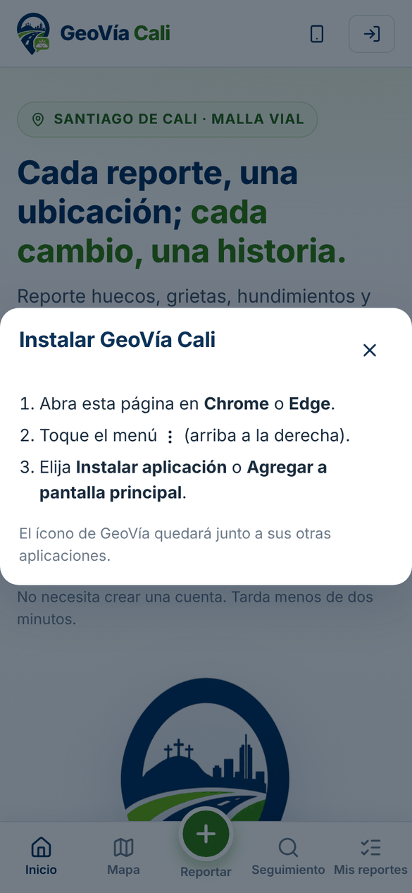</td>
<td>

**Android (Chrome o Edge)**
1. Abra la dirección de GeoVía Cali.
2. Toque **Instalar app** (arriba) o la tarjeta *Lleve GeoVía en su celular* de la pantalla de inicio.
3. Si no aparece, abra el menú **⋮** → **Instalar aplicación** o **Agregar a pantalla principal**.

**iPhone (Safari)**
1. Abra la dirección en **Safari**.
2. Toque **Compartir** (cuadro con flecha hacia arriba).
3. Elija **Agregar a pantalla de inicio** → **Agregar**.

El ícono de GeoVía aparecerá junto a sus otras aplicaciones. Mantener presionado el ícono (Android) muestra accesos directos a **Reportar**, **Mapa** y **Seguimiento**.
</td>
</tr></table>

---

## 3. Pantalla de inicio

<table><tr>
<td width="40%">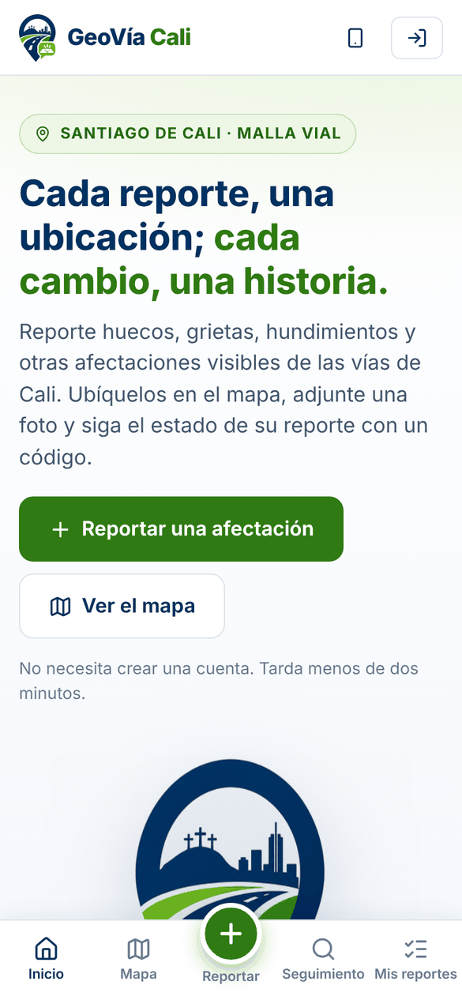</td>
<td>

Desde el inicio puede:

- **Reportar una afectación** (botón verde).
- **Ver el mapa** de reportes validados.
- Consultar cifras: reportes registrados, validados, en revisión y nuevos en los últimos 7 días.
- Ver los tipos de daño más reportados.
- Instalar la app y acceder a la política de privacidad y al **Centro de ayuda**.

**Navegación**

- En el celular, use la barra inferior: **Inicio · Mapa · Reportar (+) · Seguimiento · Mis reportes** (o **Panel**, si es revisor).
- En el computador, el menú está en la parte superior.
</td>
</tr></table>

---

## 4. Reportar un daño paso a paso

El reporte tiene **4 pasos** y toma menos de dos minutos. La barra de progreso indica en qué paso va. Puede volver atrás sin perder lo escrito.

### Paso 1 · Ubicación

<table><tr>
<td width="40%">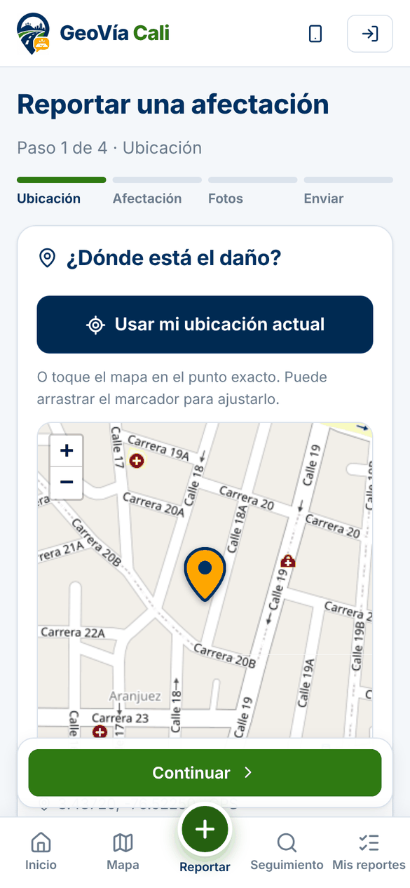</td>
<td>

1. Toque **Usar mi ubicación actual**. El navegador le pedirá permiso la primera vez.
2. Si la precisión es baja, o si no está en el lugar, **toque el mapa** en el punto exacto del daño.
3. **Arrastre el marcador amarillo** para ajustar la posición.
4. La app sugiere la **dirección** y el **barrio**; puede corregirlos.

> ⚠️ **Posible duplicado:** si ya existe un reporte a menos de 30 m, la app lo muestra con su código. Si es el mismo daño, no hace falta reportarlo otra vez; si es otro, continúe.

Solo se aceptan ubicaciones dentro de Santiago de Cali.
</td>
</tr></table>

### Paso 2 · Tipo de afectación

<table><tr>
<td width="40%">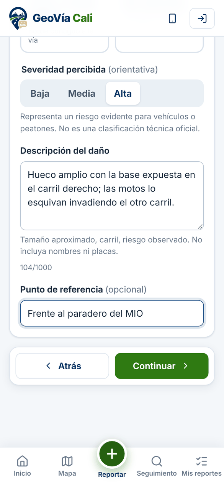</td>
<td>

1. Elija el **tipo de daño**:

   | Tipo | Cuándo usarlo |
   |---|---|
   | Hueco o bache | Cavidad en la vía |
   | Grietas o fisuras | Fisuras en el pavimento |
   | Hundimiento | Calzada asentada o deprimida |
   | Desgaste de la capa | Material suelto o descascarado |
   | Tapa o sumidero dañado | Tapa rota, hundida o ausente |
   | Señalización vial borrada | Demarcación deteriorada |
   | Andén o bordillo dañado | Borde contiguo a la vía |
   | Otra afectación | No está en la lista |

2. Indique la **severidad que percibe** (Baja, Media o Alta). Es orientativa, no técnica.
3. Escriba la **descripción** (mínimo 15 caracteres): tamaño aproximado, carril y riesgo observado. El contador le indica cuánto lleva.
4. Opcional: agregue un **punto de referencia** (“frente al paradero”).
</td>
</tr></table>

### Paso 3 · Fotografías

<table><tr>
<td width="40%">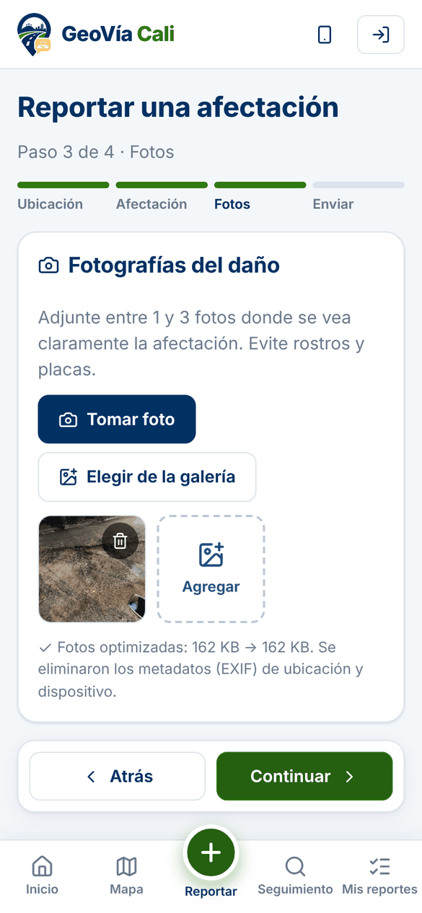</td>
<td>

1. Toque **Tomar foto** para usar la cámara trasera, o **Elegir de la galería**.
2. Adjunte entre **1 y 3 fotos** donde se vea claramente el daño.
3. Para quitar una foto, toque el ícono de la papelera.

La app **reduce el tamaño de la foto** (ahorra datos) y **elimina los metadatos** que guarda el teléfono, como la ubicación GPS y el modelo del equipo.

> Evite que aparezcan rostros o placas de vehículos.

Formatos admitidos: JPG, PNG, WebP y HEIC (máx. 15 MB por foto).
</td>
</tr></table>

### Paso 4 · Revisar y enviar

<table><tr>
<td width="40%">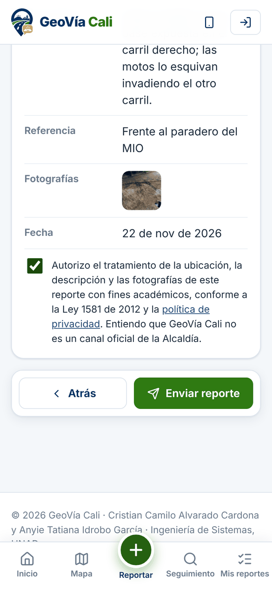</td>
<td>

1. Revise el resumen: tipo, ubicación, descripción, referencia y fotos.
2. Marque la casilla de **autorización de tratamiento de datos** (Ley 1581 de 2012).
3. Toque **Enviar reporte**. Verá el avance: *preparando sesión → subiendo fotografía → registrando el reporte*.

Si no hay conexión, la app le avisa y conserva el borrador para enviarlo después.
</td>
</tr></table>

### Confirmación

<table><tr>
<td width="40%">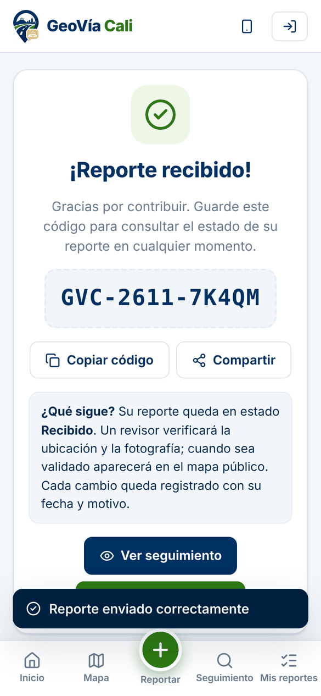</td>
<td>

Al terminar recibe un **código de seguimiento** con el formato `GVC-AAMM-XXXXX` (por ejemplo, `GVC-2611-7K4QM`).

- **Copiar código** o **Compartir** (por WhatsApp, correo, etc.).
- **Ver seguimiento** abre la ficha del reporte.
- **Reportar otro daño** inicia un reporte nuevo.

El código queda guardado en el dispositivo, en **Mis reportes** y en **Seguimiento**.
</td>
</tr></table>

---

## 5. Consultar el mapa

<table><tr>
<td width="33%">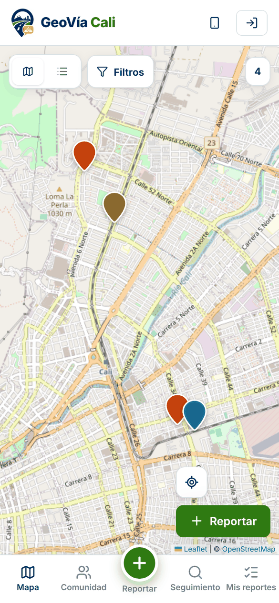</td>
<td width="33%">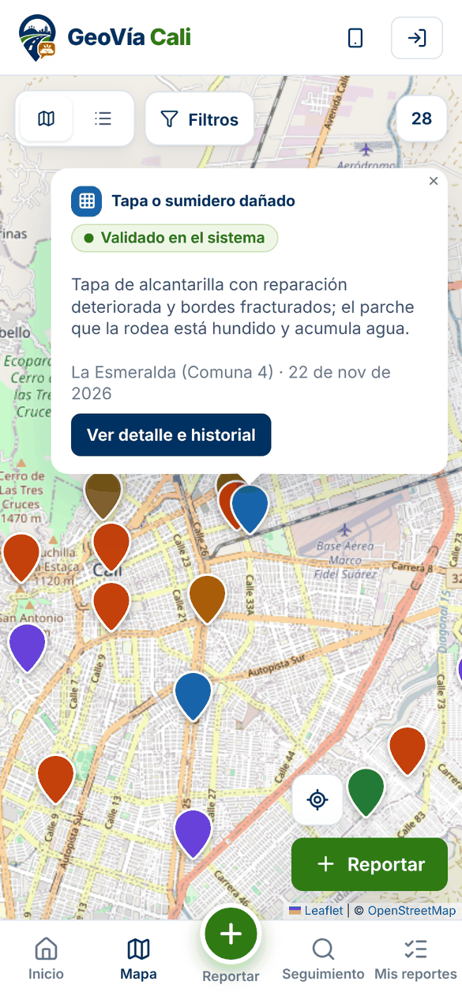</td>
<td width="33%">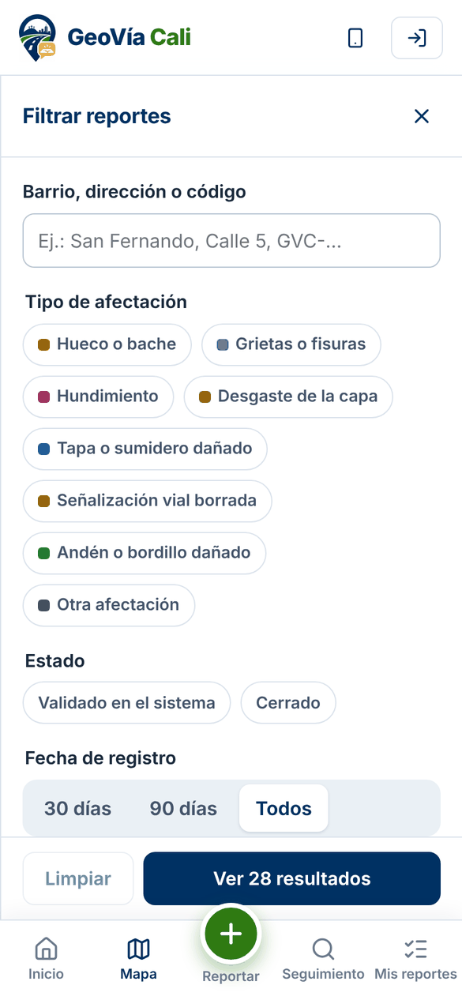</td>
</tr><tr>
<td>Cada marcador tiene el <b>color y el ícono</b> del tipo de daño. El contador (arriba a la derecha) indica cuántos reportes se muestran.</td>
<td>Toque un marcador para ver tipo, estado, descripción, barrio y fecha. <b>Ver detalle e historial</b> abre la ficha completa.</td>
<td><b>Filtros</b>: barrio, dirección o código; tipo de afectación; estado; fecha (30 días, 90 días o todos). <b>Limpiar</b> quita los filtros.</td>
</tr></table>

<table><tr>
<td width="40%">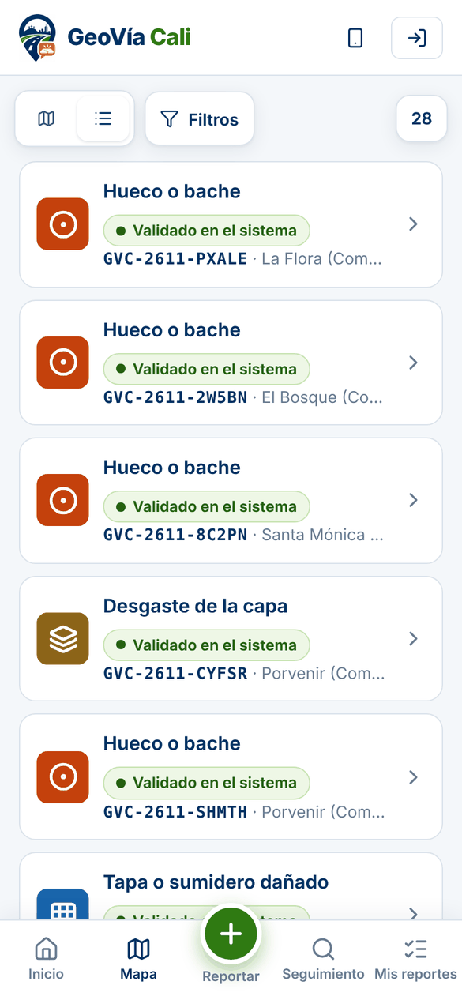</td>
<td>

**Vista de lista:** el botón con líneas (arriba a la izquierda) muestra los mismos reportes como lista, útil con lectores de pantalla o conexiones lentas.

**Otros controles**

- **Mi ubicación** (botón con mira): centra el mapa donde usted está.
- **+ Reportar**: atajo para crear un reporte.
- En el computador, la **leyenda** explica los colores y el tiempo de carga de los datos.

El mapa muestra **todos los reportes desde que se reciben**. Los que aún no verifica un revisor tienen **borde punteado** (estado *Recibido* o *En revisión*); al validarse, el marcador pasa a ser sólido. Los reportes **rechazados** dejan de mostrarse al público.
</td>
</tr></table>

---

## 6. Hacer seguimiento a un reporte

<table><tr>
<td width="33%">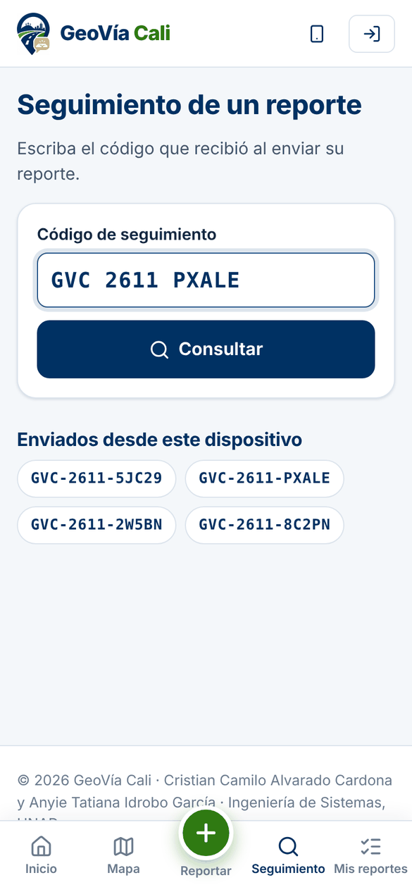</td>
<td width="33%">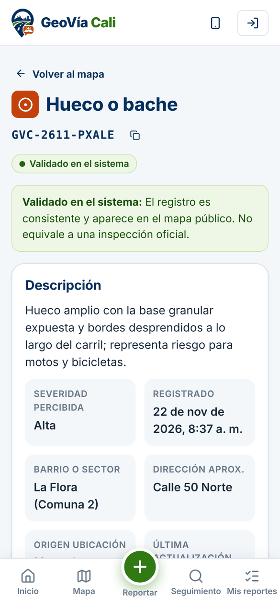</td>
<td width="33%">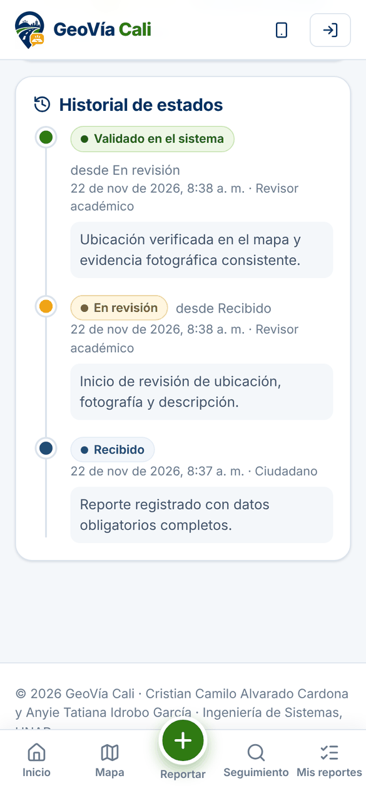</td>
</tr><tr>
<td>En <b>Seguimiento</b> escriba el código (con o sin guiones, en mayúsculas o minúsculas) y toque <b>Consultar</b>. Abajo aparecen los códigos enviados desde ese dispositivo.</td>
<td>La <b>ficha</b> muestra el estado con su explicación, la descripción, la severidad, el barrio, la dirección, las fotos (tóquelas para ampliarlas) y un mapa con <b>Abrir en Maps</b>.</td>
<td>El <b>historial de estados</b> muestra cada cambio con fecha, hora, rol responsable y motivo. Nadie puede modificarlo ni borrarlo.</td>
</tr></table>

> Todos los reportes son públicos desde que se reciben, salvo los **rechazados**: de esos, otras personas solo ven el estado y el historial con el motivo.

---

## 7. Mis reportes y cuenta opcional

<table><tr>
<td width="33%">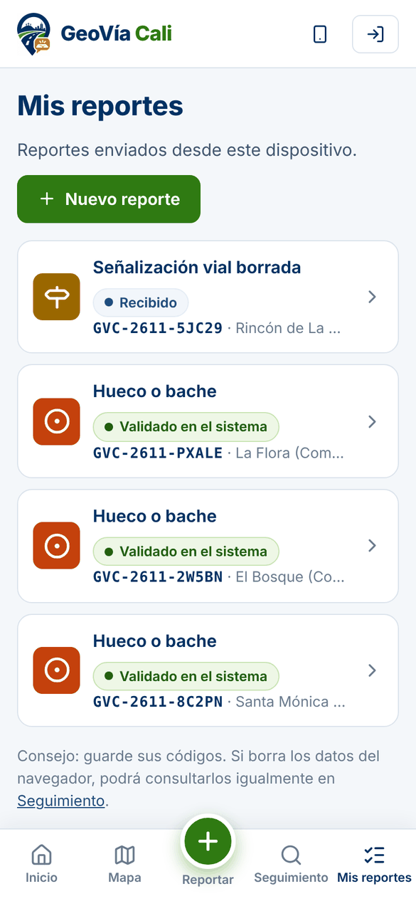</td>
<td width="33%">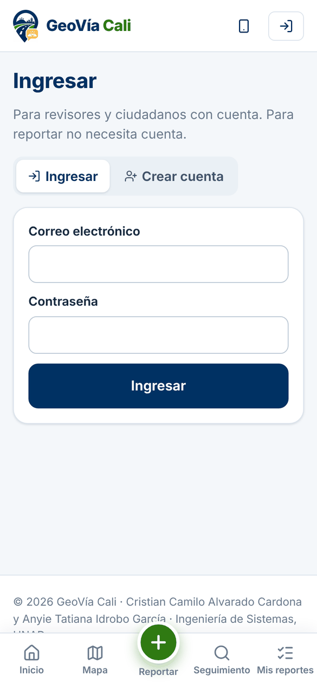</td>
<td>

**Mis reportes** reúne todo lo que ha enviado desde ese dispositivo, con su estado actualizado. Toque uno para abrir su ficha.

**Cuenta (opcional)**: en **Ingresar → Crear cuenta** registre correo y contraseña (mínimo 8 caracteres). Con una cuenta:

- ve sus reportes desde cualquier dispositivo;
- los reportes que envió antes sin cuenta siguen apareciendo en **Mis reportes** de ese dispositivo (se consultan por su código).

Los revisores y el administrador **siempre** ingresan con su cuenta.
</td>
</tr></table>

### Comunidad y actualización de reportes

<table><tr>
<td width="40%">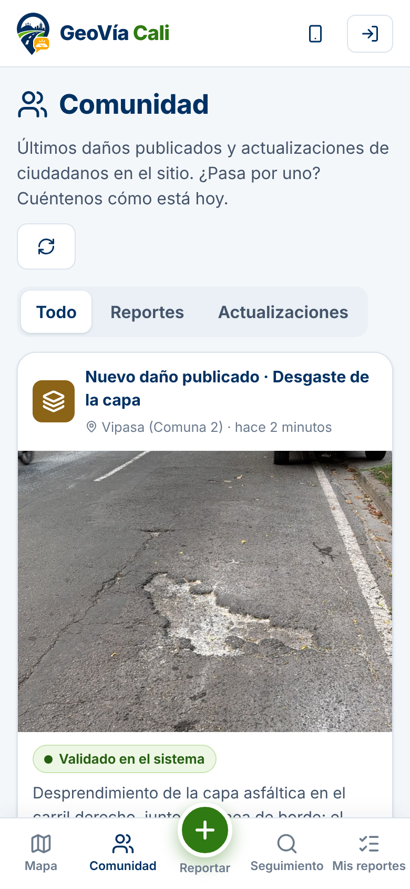</td>
<td>

En **Comunidad** (barra inferior) verá un muro con:

- **Nuevos daños publicados**: reportes validados, con foto, barrio y fecha.
- **Actualizaciones ciudadanas**: personas que pasaron por el lugar e informaron si el daño **sigue igual**, **empeoró**, **mejoró** o **ya lo arreglaron**.

Use los filtros **Todo · Reportes · Actualizaciones**. Cada publicación tiene **Ver detalle** y **Actualizar**.
</td>
</tr></table>

<table><tr>
<td width="40%">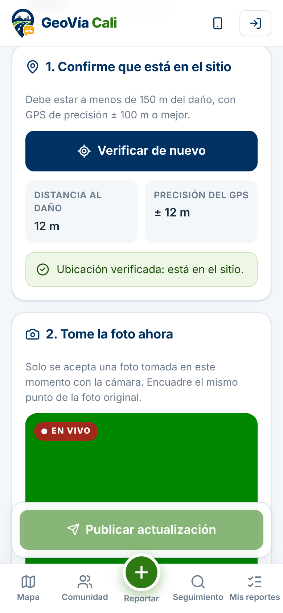</td>
<td>

**Para actualizar un reporte** debe estar en el lugar del daño:

1. Toque **Actualizar** en Comunidad, en el mapa o en la ficha del reporte.
2. **Verificar mi ubicación**: la app usa el GPS y muestra a cuántos metros está del daño. Debe estar a **menos de 150 m** y con precisión de **± 100 m o mejor**. Si no, acérquese o busque cielo abierto y toque **Verificar de nuevo**.
3. **Abrir cámara** y tome la foto con el botón amarillo. **No se pueden usar fotos de la galería**: la foto debe ser del momento. Puede tocar **Tomar otra** si no quedó bien.
4. Elija cómo está el daño ahora y, si quiere, escriba un comentario corto (hasta 300 caracteres).
5. Acepte el tratamiento de datos y toque **Publicar actualización**.

Su ubicación exacta **solo se usa para verificar** que está en el sitio y **no se publica**. Puede actualizar cada reporte una vez por hora.
</td>
</tr></table>

### Apoyos, compartir, zonas críticas y estadísticas

- **«Yo también lo vi»**: en la comunidad, en la ficha o en el mapa, toque este botón si también ha visto el daño. El número muestra cuántas personas lo respaldan. Tóquelo de nuevo para retirar su apoyo. Los reportes más apoyados suben en la cola de revisión.
- **Compartir**: el botón con el ícono de compartir abre el menú del celular (WhatsApp, Telegram, correo…) con el enlace del reporte.
- **Zonas críticas**: en el mapa, toque **Zonas críticas** para ver un mapa de calor que resalta en naranja y rojo dónde se concentran los daños. Tóquelo de nuevo para ocultarlo.
- **Estadísticas** (menú superior o pie de página): tendencia semanal, tipos de daño, barrios más afectados, avance de la verificación, tiempo típico hasta la verificación y los reportes más apoyados. Al final, **Datos abiertos** permite descargar los reportes en **GeoJSON** (QGIS, ArcGIS) o **CSV** (Excel, Power BI), sin datos personales.

---

## 8. Para revisores: moderar reportes

El rol de revisor lo asigna el administrador. Después de ingresar, aparece **Panel** en el menú.

### Panel de revisión

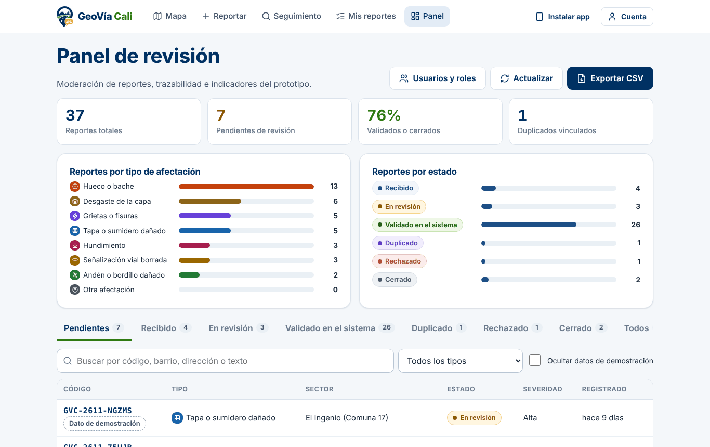

- **Indicadores**: total de reportes, pendientes, porcentaje validado o cerrado y duplicados vinculados.
- **Gráficas** por tipo de afectación y por estado.
- **Pestañas por estado.** *Pendientes* (Recibido + En revisión) se ordena por **prioridad**: primero los más apoyados por la ciudadanía y, a igual apoyo, los más antiguos. La columna **Apoyos** muestra el respaldo de cada reporte.
- **Búsqueda** por código, barrio, dirección o texto, y filtro por tipo.
- **Ocultar datos de demostración** para trabajar solo con reportes ciudadanos.
- **Exportar CSV**: descarga la vista actual **sin datos personales**, lista para Excel.

### Cambiar el estado de un reporte

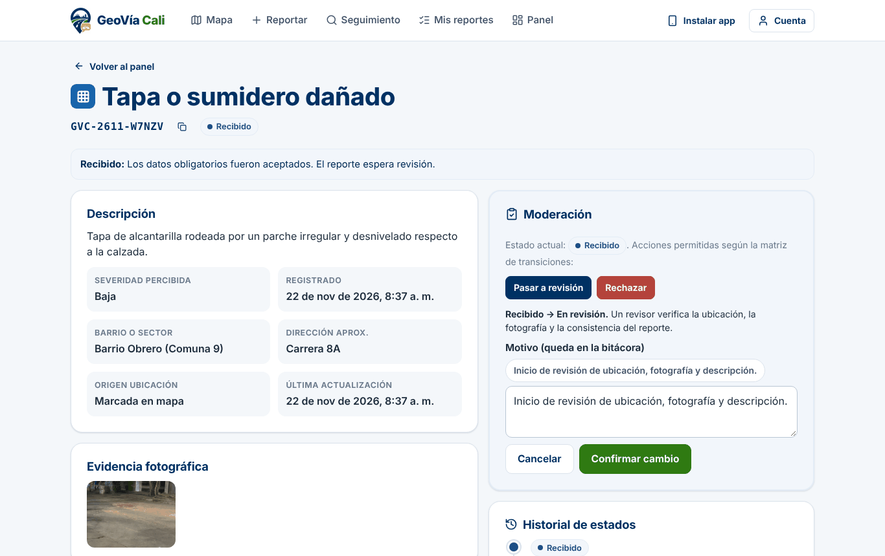

1. Abra un reporte desde el panel. A la derecha aparece la tarjeta **Moderación**.
2. Solo se muestran las **acciones permitidas** para el estado actual (ver [sección 10](#10-estados-de-un-reporte)).
3. Elija la acción y escriba el **motivo** (mínimo 10 caracteres) o toque uno de los motivos sugeridos.
4. Para **Marcar duplicado**, seleccione el reporte principal en la lista de reportes cercanos (hasta 150 m).
5. Toque **Confirmar cambio**. El historial se actualiza y, si validó el reporte, este aparece en el mapa público.

**Criterios recomendados**

| Acción | Úsela cuando… |
|---|---|
| Pasar a revisión | Va a verificar el reporte |
| Validar | La ubicación está sobre la vía, la foto muestra el daño y la descripción es coherente |
| Marcar duplicado | Otro reporte cercano describe el mismo daño |
| Rechazar | Está fuera de la vía pública, la foto es ajena o ilegible, o el contenido no corresponde |
| Cerrar | Terminó el seguimiento del reporte |

---

## 9. Para el administrador: usuarios y roles

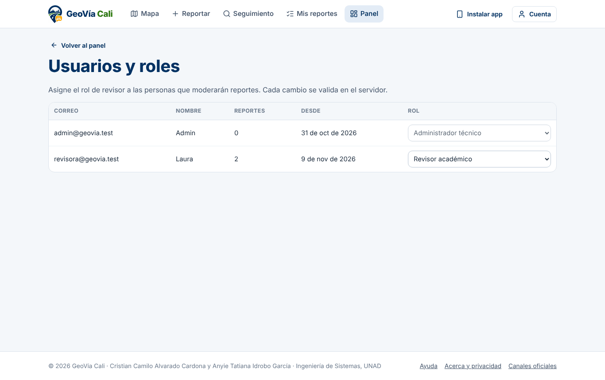

En **Panel → Usuarios y roles** se listan las cuentas registradas, con su número de reportes. Cambie el rol en la columna **Rol**; el cambio se aplica de inmediato y se valida en el servidor.

- Las sesiones anónimas no aparecen en la lista ni pueden recibir roles.
- El administrador no puede quitarse su propio rol, para evitar que la plataforma quede sin administrador.

---

## 10. Estados de un reporte

| Estado | Significado | Puede pasar a |
|---|---|---|
| **Recibido** | Los datos obligatorios fueron aceptados; espera revisión | En revisión, Rechazado |
| **En revisión** | Un revisor verifica la ubicación, la fotografía y la consistencia | Validado, Duplicado, Rechazado |
| **Validado en el sistema** | Registro consistente, visible en el mapa público. *No equivale a una inspección oficial* | Cerrado, En revisión |
| **Duplicado** | Coincide con otro reporte; queda vinculado al principal | Cerrado, En revisión |
| **Rechazado** | No cumple los criterios | En revisión |
| **Cerrado** | Finalizó el seguimiento | En revisión |

---

## 11. Privacidad y buen uso

- Para reportar **no se piden datos personales**. Si crea una cuenta, solo se guardan su correo y un nombre o alias opcional.
- Las fotos se procesan en su teléfono y **se eliminan sus metadatos**, incluida la ubicación GPS.
- El mapa público **no muestra quién reportó**.
- Las fotos se guardan en almacenamiento privado y se muestran con enlaces temporales.
- Puede solicitar la consulta, corrección o eliminación de sus datos al equipo del proyecto.
- **No incluya** rostros, placas, nombres ni teléfonos en fotos o descripciones.
- GeoVía Cali **no es un canal oficial** de la Alcaldía de Santiago de Cali ni garantiza reparaciones. **Emergencias: 123.**

La política completa está en la app, en **Acerca y privacidad**.

---

## 12. Solución de problemas

| Problema | Solución |
|---|---|
| “No se concedió permiso de ubicación” | Habilite la ubicación para el sitio (candado junto a la dirección web → Permisos), o marque el punto tocando el mapa |
| “La ubicación debe estar dentro de Santiago de Cali” | Mueva el marcador al lugar del daño dentro de la ciudad |
| No puedo continuar en el paso 2 | Revise que eligió un tipo y que la descripción tiene al menos 15 caracteres |
| “Formato no admitido” | Use fotos JPG, PNG, WebP o HEIC |
| “No hay conexión con el servidor” | Revise su conexión; el borrador está guardado. Vuelva a adjuntar la foto si cerró la app |
| “Ha alcanzado el límite de reportes por hora” | Medida contra el abuso (10 por hora). Intente más tarde |
| No aparece el botón Instalar | Use el menú del navegador ([sección 2](#2-instalar-la-app-en-el-celular)); si ya está instalada, el botón se oculta |
| No veo mi reporte en el mapa | Aún no está validado; consulte su estado en Seguimiento |
| Olvidé mi código | Búsquelo en Mis reportes o en Seguimiento, desde el mismo dispositivo |
| “Está a X m del daño” al actualizar | Acérquese al punto del daño (menos de 150 m) y verifique de nuevo |
| “La precisión del GPS es insuficiente” | Salga a cielo abierto, espere unos segundos y verifique de nuevo |
| “No se concedió permiso para usar la cámara” | Candado junto a la dirección web → Cámara → Permitir; luego **Reintentar** |

Dentro de la app también está el **Centro de ayuda** (enlace al pie de cada página), con preguntas frecuentes.

---

GeoVía Cali · Cristian Camilo Alvarado Cardona y Anyie Tatiana Idrobo García · Ingeniería de Sistemas, UNAD

